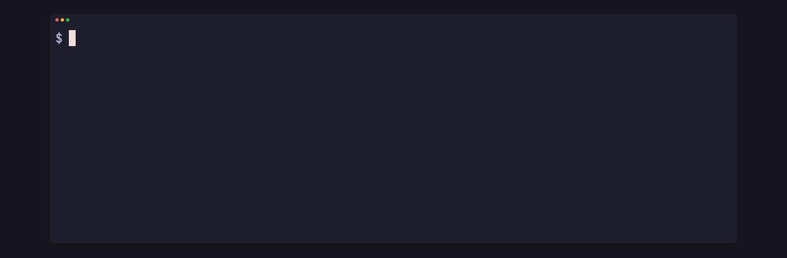
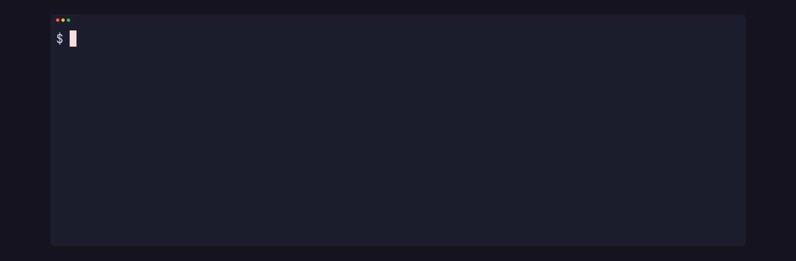
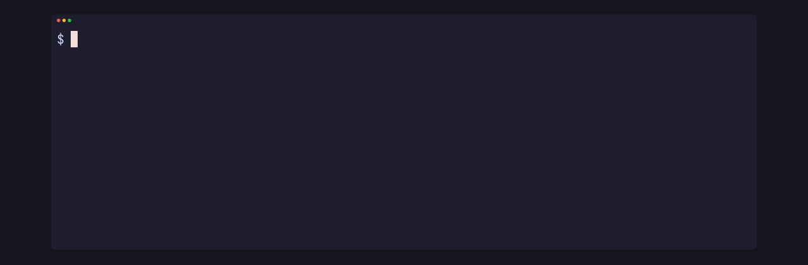
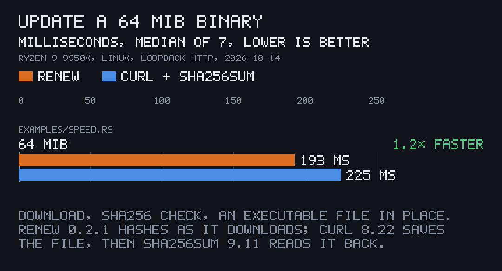
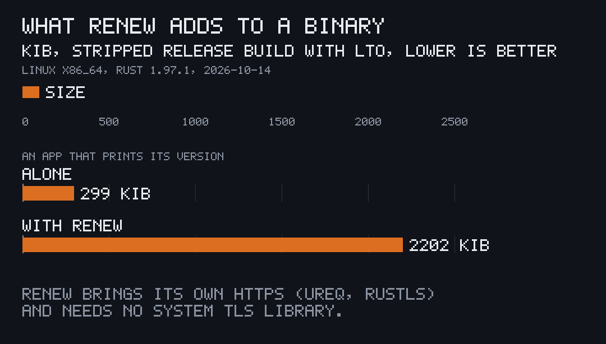

<p align="center"></p>

# pito-renew

[](https://github.com/gmrdad82/pito-renew/actions/workflows/ci.yml)
[](https://github.com/gmrdad82/pito-renew/tags)

Self-update for a Rust app, in one small crate, `renew`, part of
[PITO MD](https://pitomd.com). Three calls: `check` fetches a signed release
manifest, `install` downloads this platform's binary and swaps it in place of
the running executable, `restart` relaunches it. Nothing runs or stays on disk
unless the manifest's minisign signature verifies against the key the app
carries and the binary's size and sha256 match what was signed.

| | |
|---|---|
| Check for an update | **0.47 ms** on loopback, signature verified |
| Download, verify and swap 64 MiB | **193 ms** on loopback, 1.2× faster than `curl` then `sha256sum` |
| Library code | **378 lines** of Rust, no `unsafe` |
| Dependencies | **7** direct, 44 in all, no system TLS library |
| Added to a stripped release binary | **1.86 MiB**, HTTPS included |

[How each number was measured](#how-it-measures). Works on Linux and macOS
(Windows through WSL), CI-tested on both.

## Install and first use

Add it from git, pinned to a release tag (it isn't on crates.io):

```toml
renew = { git = "https://github.com/gmrdad82/pito-renew", tag = "v0.2.1" }
```

The same line works on Linux and macOS. Then, in the app, at start-up or
when the user asks to check for updates:

```rust
const MANIFEST_URL: &str = "https://example.com/app/manifest.json";
const RELEASE_KEY: &str = "RWQ…";

fn update() -> Result<(), Box<dyn std::error::Error>> {
    let exe = std::env::current_exe()?;
    renew::clean_old_binary(&exe);
    let check = renew::check(MANIFEST_URL, RELEASE_KEY, env!("CARGO_PKG_VERSION"))?;
    if let Some(update) = check.update {
        renew::install(&update.binary, &exe)?;
        renew::restart(&exe)?;
        std::process::exit(0);
    }
    Ok(())
}
```

See it work, with no network and nothing to set up, from a checkout:

```sh
git clone https://github.com/gmrdad82/pito-renew && cd pito-renew
cargo run --example demo
```

The demo makes a key pair, signs a manifest, serves it with its signature and
a binary from a local port, and updates an app at 1.0.0 in a temporary folder
to 1.1.0: the clip at the top. `--tampered`, `--forged` and `--major` show
the refusals and a new major, below.

## What it does

### Updates in place

`check` answers whether a newer release is out; `install` streams it to
`<exe>.staging`, hashing as it goes, and renames it over the running
executable in one step; `restart` spawns the new binary detached so the app
can exit. The app keeps its own ceremony around it, such as a backup first,
and picks its own moment. It keeps no state: call `check` as often as you
like.

### Refuses a manifest it didn't sign

<p align="center"></p>

The manifest is signed with [minisign](https://jedisct1.github.io/minisign/)
and the app carries the public key. `check` verifies the signature over the
exact bytes before it reads a single field, so a hijacked host or a swapped
manifest can't point the app anywhere. It also refuses plain http to any host
but this machine, a manifest over 1 MiB, a sha256 that isn't 64 hex digits,
and a published size of 0 or over 512 MiB.

### Refuses a binary that doesn't match

The second half of the clip at the top: `demo --tampered` serves other bytes
of the same size. `install` stops as soon as more bytes arrive than were
published, checks the exact size and the sha256, and on any mismatch removes
its staging file and leaves the old binary where it was. It never writes
through an existing file or link: if `<exe>.staging` is already there, it
refuses.

### Crosses major versions

<p align="center"></p>

An app at 1.4.2 takes 2.0.0 like any other update, and `check` also hands
back the release as `new_major`, so the app can tell the user. If a new major
ships without a binary for some platform, apps there keep getting the newest
release of their own major. Versions compare by semver, ignoring build
metadata, and a replayed older manifest offers no update.

### Fast

<p align="center"></p>

`install` hashes while it downloads, so the binary is read once; the usual
script downloads with `curl`, then reads the file back with `sha256sum`. Over a
real network the download dominates either way; the point is that verifying
costs no extra pass. A `check` is two small requests and one signature check:
0.47 ms on loopback, bounded by a 3 s timeout over a real network.

### Small

<p align="center"></p>

378 lines of library code and seven direct dependencies: HTTP is
[ureq](https://crates.io/crates/ureq) with rustls, so it needs no system TLS
library, the signature check is
[minisign-verify](https://crates.io/crates/minisign-verify), and the
streaming sha256 is [pito-fetch](https://github.com/gmrdad82/pito-fetch)'s.

## The manifest

```json
{
  "version": "1.1.0",
  "platforms": {
    "linux-x86_64": { "url": "https://example.com/app/1.1.0/app-linux-x86_64", "sha256": "…", "size": 10485760 },
    "macos-arm64": { "url": "https://example.com/app/1.1.0/app-macos-arm64", "sha256": "…", "size": 9437184 }
  }
}
```

The top-level `version` and `platforms` are the newest release. If a new
major ships without a binary for some platform, list the newest release of
each older major under `releases`, so apps on that platform keep getting that
major's updates:

```json
{
  "version": "2.0.0",
  "platforms": { "linux-x86_64": { "url": "…", "sha256": "…", "size": 11534336 } },
  "releases": [
    { "version": "1.5.1", "platforms": { "linux-x86_64": { "url": "…", "sha256": "…", "size": 10485760 } } }
  ]
}
```

The platform keys are `linux-x86_64`, `macos-arm64` and `windows-x86_64`;
`renew::platform_key()` gives this build's key, or an empty string on any
other platform. Each `url` points to the raw executable, not an archive, and
each `sha256` is its 64 hex digits.

Sign it with minisign. Make a key pair once with `minisign -G`, and keep the
secret key off the server that hosts the releases. For each release,
`minisign -Sm manifest.json` writes `manifest.json.minisig` next to the
manifest; serve both over HTTPS, the signature at the manifest's URL with
`.minisig` appended. The app carries the public key, the second line of
`minisign.pub` (it starts with `RW`).

## The API

```rust
use std::error::Error;

use renew::Check;

const RELEASE_KEY: &str = "RWQ…";

fn update() -> Result<(), Box<dyn Error>> {
    let exe = std::env::current_exe()?;
    renew::clean_old_binary(&exe);
    let Check { update, new_major } = renew::check(
        "https://example.com/app/manifest.json",
        RELEASE_KEY,
        env!("CARGO_PKG_VERSION"),
    )?;
    let Some(update) = update else {
        return Ok(());
    };
    if new_major.is_some() {
        println!("{} is a new major version", update.version);
    }
    println!("installing {}", update.version);
    renew::install(&update.binary, &exe)?;
    renew::restart(&exe)?;
    std::process::exit(0);
}
```

- `check(url, public_key, current)` fetches the manifest (at most 1 MiB) and
  its `.minisig` (at most 4 KiB), each with a 3 s timeout, verifies the
  signature over the exact manifest bytes, and answers a `Check` with two
  fields, each a `Release` (the version and this platform's binary) or
  `None`: `update`, the newest release newer than the running one, whatever
  its major, and `new_major`, the same release when it is a later major.
- `install(&binary, &exe)` downloads over HTTPS (plain http only to this
  machine) to `<exe>.staging` (180 s timeout), created by it with mode 0755,
  checks the size and the sha256, and renames the file over `exe`. On any
  failure the staging file it made is removed and the old binary stays.
- `restart(&exe)` spawns the new binary detached, with no stdin, stdout or
  stderr; the app exits after it.
- `clean_old_binary(&exe)` sweeps a leftover `<exe>.staging` or `<exe>.old`;
  call it at start-up.

Every failure is a `RenewError` naming what went wrong: the manifest
unreachable (its signature missing included) or malformed, a public key that
isn't a minisign key, a signature that doesn't verify, a plain http URL, no
binary for this platform, a failed download, a bad version string, or a
staging, verification or swap error.

The crate also builds for native Windows, where the swap parks the running
binary as `<exe>.old` first; CI doesn't run that path, so it is untested.

## How it measures

All on one machine, 2026-10-14: AMD Ryzen 9 9950X (16 cores), Linux 7.2,
Rust 1.97.1, renew 0.2.1. Measured once; the numbers are as printed.

- **Check and update speed:** `cargo run --release --example speed`. It serves
  a signed manifest and a 64 MiB binary from a local port, times 100 `check`
  calls and 7 `install`s of the 64 MiB binary, and times 7 runs of
  `curl -fsS -o app <url> && sha256sum app && chmod 755 app` (curl 8.22,
  GNU coreutils 9.11) against the same server and file; medians. It printed
  `check 0.47 ms`, `install 193 ms (332 MiB/s)`, `shell 225 ms (285 MiB/s)`.
  Loopback HTTP, so these measure renew's own cost, not a network.
- **Size:** two copies of a small app that prints its version, one alone and
  one that calls `check`, `install` and `restart`, built with
  `--release`, `lto = true`, `codegen-units = 1`, `strip = true` for
  linux-x86_64: 306,560 and 2,254,504 bytes. The difference, 1.86 MiB, is
  mostly HTTPS (ureq, rustls and its crypto). A cold release build of the
  second took 50 s on the same machine.
- **Lines and dependencies:** `src/` without its tests, and
  `cargo tree -e normal`.

## Part of PITO MD

renew is the self-update of the [PITO MD](https://pitomd.com) apps. It hashes
with [pito-fetch](https://github.com/gmrdad82/pito-fetch), and sits beside
[pito-storekit](https://github.com/gmrdad82/pito-storekit) (the apps' SQLite
store and its backups) and [pito-tui](https://github.com/gmrdad82/pito-tui)
(the terminal app shell). The clips here were recorded with
[prec](https://github.com/gmrdad82/prec) and made into GIFs with
[pconv](https://github.com/gmrdad82/pconv), and the charts drawn with
[pito-compare](https://github.com/gmrdad82/pito-compare).

## Build and test

```sh
bin/gate
```

runs rustfmt, clippy with warnings as errors, and the tests. The tests serve
their downloads from a local port and write their scratch files under
`tmp/`, so they need no network.

## Contributing

Issues and pull requests are welcome. Please read the
[code of conduct](CODE_OF_CONDUCT.md) first. A change keeps `bin/gate` green
with no warnings, and never lets a binary run or stay in place unless the
manifest's signature verifies and the binary's size and sha256 match it.
Report a security issue privately, as [SECURITY.md](SECURITY.md) says, not in
a public issue.

## Licence

The code is MIT licensed, © Catalin Ilinca: see [LICENSE](LICENSE). The MIT
grant covers the code only: the PITO MD name and its logos are © Catalin Ilinca,
all rights reserved, and are not covered by it; see
[TRADEMARKS.md](TRADEMARKS.md).
